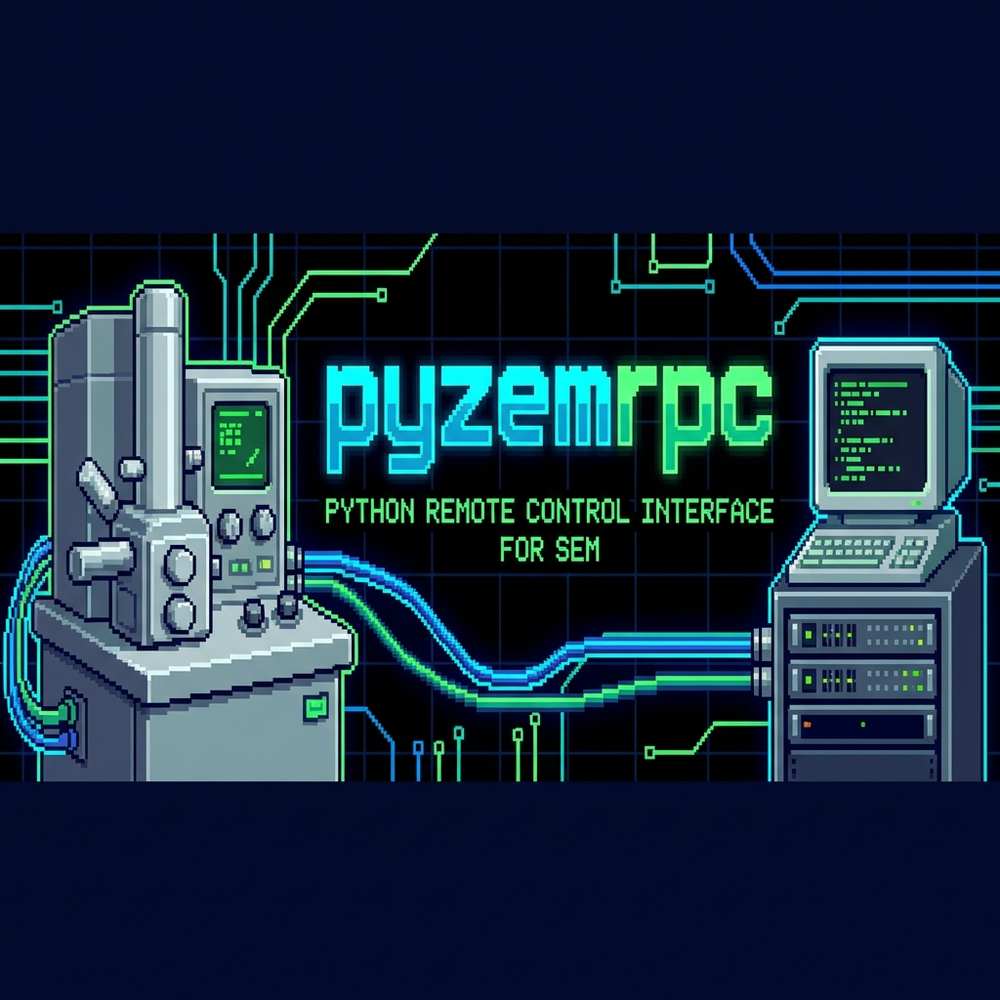

# pyzemrpc

**发布约束：先提交，再重新构建打包。** 包内 Git 元数据必须对应实际源码提交，不得混入未提交改动或复用提交前构建的旧包。Agent 及发布流程遵守根目录 [AGENTS.md](AGENTS.md)。

新增 [扫描档位使能掩码](docs/scan_relay_mask.md)：UDP 设置/查询、JSON-RPC 状态读回；掩码 7 禁用 K4，15 恢复全部档位。

[对焦、像散和对中接口](docs/optics_control.md)：JSON-RPC 像散/上下对中控制与 `Status.optics` 当前值，以及物镜 DAC、自动对焦和原有 UDP 调用示例；上位机“像散”页手动读写 X/Y 百分比与 A/B DAC。

**ZEM远程控制接口（python版本）**

`pyzemrpc` 是安徽泽攸科技（ZEPTOOLS）扫描电镜（SEM）的Python远程控制接口与工具集。它提供了一套Python API，允许开发者通过代码控制SEM设备，以及一个图形用户界面（GUI）用于交互式操作。

---

## ✨ 特性 (Features)

*   **远程控制**: 支持对ZEM系列扫描电镜的远程操作与监控。
*   **Python API**: 提供友好的Python接口，便于集成到自动化脚本或第三方软件中。
*   **图形界面**: 内置 `pyzemrpc` GUI 工具，开箱即用。
*   **配置灵活**: 基于 YAML 和 数据库 的灵活配置管理。

## 🚀 安装 (Installation)

### 依赖环境
*   Python 3.10+
*   Windows / Linux / MacOS

### 安装步骤

1.  克隆仓库：
    ```bash
    git clone https://gitee.com/zeyou-anhui/pyzemrpc.git
    cd pyzemrpc
    ```

2.  安装依赖并安装包：
    ```bash
    pip install .
    ```

    或者使用开发模式安装：
    ```bash
    pip install -e .
    ```

3.  或者使用pypi安装
    ```bash
    pip install pyzemrpc
    ```


## 🖥️ 使用 (Usage)

### 启动 GUI
安装完成后，可以直接在终端运行以下命令启动图形界面：
```bash
pyzemrpc
```

上位机“对焦”页独立用于物镜对焦，不依赖设备支持鱼眼功能。“鱼眼”页供支持该功能的设备进行模式切换、模式与焦点读回、焦点数值设置和步进微调；使用后先恢复正常模式，再操作物镜对焦页，详见[鱼眼接口与手动联调说明](docs/fisheye_mode.md)。

### 命令行工具
查看相关信息：
```bash
pyzemrpc_info
```

### Python 开发
在您的 Python 脚本中导入 `zemrpc`：

```python
import zemrpc
from zemrpc import app_cfg

# 示例代码 (具体API参考文档)
print(f"pyzemrpc version: {app_cfg.version}")
```

## 📄 文档 (Documentation)
更多详细文档和配置说明，请查阅 [doc](./doc) 目录。

## 🤝 贡献 (Contributing)
欢迎提交 Issue 或 Pull Request 来改进本项目。

## 📃 许可证 (License)
本项目采用 [MIT License](LICENSE) 开源。

---
Copyright © 2024-2026 ZEPTOOLS


### 2026-09-23 手动实时图导航

`pyzemrpc 1.2.6.dev2026092302` 提供 `device.set_roi_nav(width, height, bbox)`，UDP 为 `SetRoiNav:width,height,x0,y0,x1,y1`。两角相同只居中，矩形居中并按长边放大；电镜软件使用当前光学参数自动选择束移或移台，无需 frame token、客户端倍率或束移开关。六参数替换旧九参数接口，需同步更新 Instrument；旧视频模块仍可使用。导航超时不自动重试，accepted 表示命令接受。手动倍率仍发送 SetMag。
